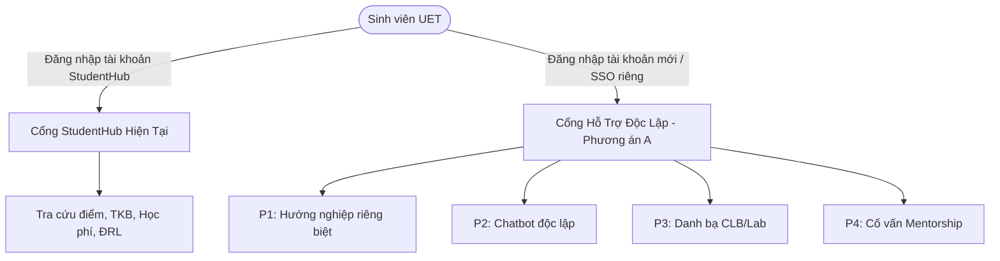
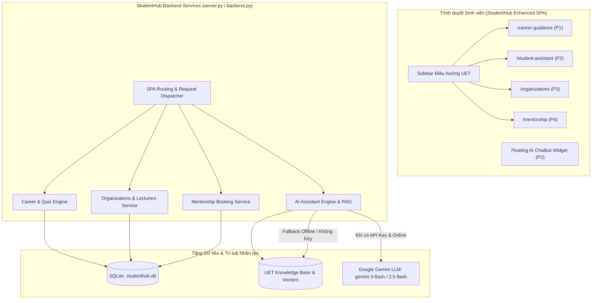
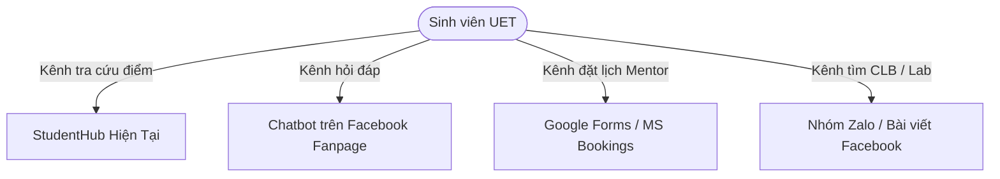

# 6 Các phương án giải pháp

Dựa trên kết quả phân tích hiện trạng tại **Mục 2**, bốn nhóm thiếu hụt cốt lõi được định vị tại **Mục 3 (P1–P4)**, phân tích nhu cầu các bên liên quan (**Mục 4**) cùng hệ thống mục tiêu, ràng buộc và tiêu chí thành công (**Mục 5**), chương này xây dựng và đánh giá các phương án kiến trúc nhằm giải quyết triệt để các bài toán đặt ra. 

Bốn vấn đề trọng tâm cần giải quyết bao gồm:
1. **P1 (Career Guidance & Gap Analysis):** Thiếu công cụ tư vấn học vụ cá nhân hóa gắn với mục tiêu nghề nghiệp, chưa có cơ chế đối chiếu năng lực thực tế với chuẩn kiến thức/học phần trong chương trình đào tạo (CTĐT) UET.
2. **P2 (Student Assistant AI):** Thiếu kênh hỏi đáp tự động bằng ngôn ngữ tự nhiên về quy chế, thủ tục, chuẩn đầu ra và học phần, thiếu nguồn kiểm chứng tin cậy.
3. **P3 (Organizations & Research Labs):** Thiếu danh bạ tập trung và kênh kết nối chính thức tới các Câu lạc bộ, Bộ môn chuyên môn và Phòng thí nghiệm nghiên cứu trực thuộc Nhà trường.
4. **P4 (Career Mentorship):** Thiếu kênh kết nối trực tiếp với cố vấn nghề nghiệp và mạng lưới cựu sinh viên để nhận tư vấn 1-on-1 về công việc thực tế, đồ án và định hướng nghề nghiệp.

Dưới đây là ba phương án giải pháp được đề xuất và xem xét kỹ lưỡng.

---

## 6.1 Phương án A: Xây dựng cổng thông tin và dịch vụ sinh viên độc lập (Standalone Portal Subsystem)

### 6.1.1 Mô tả kiến trúc tổng thể
Phương án A đề xuất phát triển một hệ thống ứng dụng web/di động hoàn toàn độc lập với StudentHub hiện tại (ví dụ: `career.uet.vnu.edu.vn` hoặc `student-support.uet.vn`). Hệ thống này sở hữu cơ sở dữ liệu riêng, máy chủ web riêng và cung cấp toàn bộ 4 tính năng mới (P1–P4) trong một môi trường cô lập.

### 6.1.2 Cơ chế giải quyết các thiếu hụt của Mục 3
- **Đối với P1:** Xây dựng một trang web trắc nghiệm và danh mục nghề nghiệp riêng. Sinh viên phải tự khai báo lại danh sách các môn đã học, điểm số hoặc tự chọn môn học từ danh sách thủ công, do hệ thống không truy cập được dữ liệu kết quả học tập từ StudentHub.
- **Đối với P2:** Tích hợp chatbot hỏi đáp trên giao diện riêng của portal độc lập.
- **Đối với P3:** Xây dựng trang danh bạ hiển thị các CLB và phòng nghiên cứu.
- **Đối với P4:** Cung cấp hệ thống đặt lịch hẹn mentor nội bộ trên portal.

### 6.1.3 Đánh giá ưu điểm và nhược điểm
- **Ưu điểm:**
  - Không can thiệp vào mã nguồn hoặc hạ tầng sẵn có của StudentHub, giúp tránh rủi ro gây lỗi cho các nghiệp vụ lõi đang hoạt động (tra cứu điểm, học phí, thủ tục hành chính).
  - Tự do lựa chọn công nghệ và framework mới nhất mà không phụ thuộc vào kiến trúc hiện tại của StudentHub.
- **Nhược điểm & Rủi ro:**
  - **Gia tăng sự phân mảnh hệ sinh thái (Fragmentation):** Như đã chỉ rõ trong Mục 2.5, sinh viên UET hiện đã phải sử dụng song song 4 hệ thống khác nhau (*StudentHub, uet.edu.vn, dangkyhoc.vnu.edu.vn, Sổ tay Sinh viên*). Việc sinh ra thêm một cổng thông tin độc lập thứ năm sẽ làm trầm trọng thêm tình trạng phân mảnh, buộc sinh viên phải nhớ thêm tài khoản/địa chỉ web, gây mệt mỏi trong trải nghiệm người dùng (Cognitive Load).
  - **Mất tính cá nhân hóa theo tiến độ học tập (Vi phạm SC03, SC04):** Không thể tự động lấy kết quả học tập, tín chỉ tích lũy và danh sách học phần sinh viên đã hoàn thành từ StudentHub để tự động tính khoảng cách kỹ năng (Skill Gap Analysis). Sinh viên phải tốn nhiều thời gian nhập liệu thủ công.
  - **Chi phí vận hành và bảo trì kép:** Đòi hỏi cấp phát thêm máy chủ, tên miền, chứng chỉ số và quy trình xác thực người dùng riêng biệt.

---

## 6.2 Phương án B: Tích hợp mở rộng trực tiếp trên nền tảng StudentHub hiện tại (Enhanced Academic SPA & Microservices Architecture)

### 6.2.1 Mô tả kiến trúc tổng thể
Phương án B lựa chọn kế thừa trực tiếp hệ thống **StudentHub hiện tại**, phát triển bổ sung 4 phân hệ tương ứng với P1–P4 dưới dạng các mô-đun chức năng tích hợp chặt chẽ:
- **Tầng giao diện (Frontend):** Bổ sung các Route Single-Page Application (SPA) vào thanh Sidebar điều hướng chính của StudentHub (`/career-guidance`, `/student-assistant`, `/organizations`, `/mentorship`) và nhúng Trợ lý AI dưới dạng **Floating Chatbot Widget** hiện diện thường trực ở góc phải màn hình trên mọi trang giao diện.
- **Tầng dịch vụ & Dữ liệu (Backend & Database):** Phát triển máy chủ dịch vụ RESTful API module hóa (`backend.py`, `career_backend.py`, `server.py`) sử dụng chuẩn HTTP và cơ sở dữ liệu quan hệ SQLite (`studenthub.db`), vận hành khép kín, an toàn và dễ triển khai.
- **Cơ chế AI Hybrid (Cloud LLM + Local Knowledge Base Fallback):** Kết hợp linh hoạt giữa các mô hình ngôn ngữ lớn tiên tiến (Google Gemini) và bộ máy truy xuất tri thức nội bộ chuẩn hóa của UET.

### 6.2.2 Chi tiết các giải pháp kỹ thuật giải quyết từng thiếu hụt của Mục 3 (Kèm hiện thực mã nguồn)

#### 1. Giải quyết P1: Tư vấn học vụ cá nhân hóa gắn với định hướng nghề nghiệp
* **Vấn đề đã chỉ ra ở Mục 3.1 & 3.2.1:** Sinh viên chưa được hỗ trợ khám phá các hướng nghề nghiệp phù hợp, chưa có cơ chế đối chiếu yêu cầu nghề nghiệp với các môn học trong CTĐT UET và chưa tính toán được khoảng cách năng lực thực tế.
* **Giải pháp kỹ thuật đã triển khai trong mã nguồn:**
  - **Mô hình dữ liệu nghề nghiệp chuẩn hóa (`ROLE_PROFILES` trong [`career_backend.py`](file:///d:/GitHub/Studenthub_UET/studenthub.uet.edu.vn/career_backend.py#L48-L56) & bảng `career_roles` trong [`backend.py`](file:///d:/GitHub/Studenthub_UET/studenthub.uet.edu.vn/backend.py#L34-L50)): Xây dựng cơ sở dữ liệu 6 vai trò nghề nghiệp CNTT phổ biến: *Full-stack Software Engineer, AI / Data Engineer, Cybersecurity Specialist, DevOps / Cloud Engineer, Embedded & IoT Engineer, Tech Product Manager*. Mỗi vai trò quy định rõ năng lực trọng tâm và mức độ yêu cầu (thang điểm 1–5).
  - **Bản đồ ánh xạ Kỹ năng – Học phần chính khóa UET (Course Mappings):** Trong [`backend.py`](file:///d:/GitHub/Studenthub_UET/studenthub.uet.edu.vn/backend.py#L120-L160), mỗi kỹ năng nghề nghiệp được gắn trực tiếp với mã môn học tương ứng trong CTĐT Khoa CNTT – UET (ví dụ: Kỹ năng lập trình hệ thống liên kết với `INT2204 - Lập trình nâng cao`, `INT2211 - Hệ điều hành`; An toàn thông tin liên kết với `INT3202 - An toàn mạng`, `INT3306 - Phát triển ứng dụng Web`, v.v.).
  - **Công cụ trắc nghiệm định hướng nghề nghiệp 20 câu hỏi (`/api/career/quiz/*`):** Thuật toán trắc nghiệm chia thành 5 nhóm tiêu chí (*analytical, creativity, systems, social, practical*), tính toán điểm số chuẩn hóa theo thang 10 và sử dụng khoảng cách vector đặc trưng để xếp hạng mức độ tương thích của sinh viên với từng ngành học, kèm liên kết trực tiếp tới khung chương trình đào tạo của Nhà trường.
  - **Đánh giá khoảng cách kỹ năng (Skill Gap Analysis) & Lưu trữ lộ trình học tập cá nhân hóa:** Sinh viên đánh giá năng lực hiện có; hệ thống tự động đối chiếu với yêu cầu của vai trò mục tiêu, trực quan hóa bằng biểu đồ radar/thanh tiến độ và lưu trữ vào bảng `career_profiles`, `career_roadmaps` trong cơ sở dữ liệu [`studenthub.db`](file:///d:/GitHub/Studenthub_UET/studenthub.uet.edu.vn/studenthub.db) (đáp ứng tiêu chí **SC01, SC02, SC03, SC04, SC05**).

#### 2. Giải quyết P2: Trợ lý sinh viên AI hỏi đáp quy chế và thông tin học tập
* **Vấn đề đã chỉ ra ở Mục 3.1 & 3.2.2:** Chưa có chatbot hỏi đáp bằng ngôn ngữ tự nhiên; sinh viên gặp khó khăn khi tra cứu các câu hỏi tổng hợp (điều kiện tiên quyết, thủ tục hoãn thi, chứng chỉ tiếng Anh, học bổng); câu trả lời trôi nổi trên mạng thiếu căn cứ kiểm chứng.
* **Giải pháp kỹ thuật đã triển khai trong mã nguồn:**
  - **Giao diện đa điểm chạm:** Tích hợp cả **Floating Chatbot Widget** (nổi ở góc dưới mọi màn hình) và trang **Trợ lý sinh viên chuyên sâu** (`/student-assistant` trong [`features.js`](file:///d:/GitHub/Studenthub_UET/studenthub.uet.edu.vn/features.js#L93-L125)).
  - **Kiến trúc Hybrid AI 2 tầng (LLM + Local RAG):** Trong hàm `process_chat_message()` của [`backend.py`](file:///d:/GitHub/Studenthub_UET/studenthub.uet.edu.vn/backend.py#L772-L845):
    - *Tầng 1 (Kho tri thức UET chuẩn hóa - Semantic Knowledge Base):* Xây dựng bộ tri thức `UET_KNOWLEDGE_BASE` với hơn 10 nhóm chủ đề cốt lõi (chuẩn đầu ra, xét tốt nghiệp, đăng ký tín chỉ, điểm rèn luyện, học bổng, miễn giảm môn, địa chỉ các phòng ban P104-E3, P105-E3).
    - *Tầng 2 (Cloud LLM Generation):* Tự động nhận diện API Key từ file bí mật `.env` (thông qua hàm tự động `load_env()` trong [`backend.py`](file:///d:/GitHub/Studenthub_UET/studenthub.uet.edu.vn/backend.py#L19-L38)) và kết nối mô hình Google Gemini thế hệ mới (`gemini-3-flash-preview` / `gemini-2.5-flash`). Prompt hệ thống được thiết kế nghiêm ngặt: đóng vai Trợ lý sinh viên UET, giải đáp dựa trên dữ liệu chuẩn, tuyệt đối không bịa đặt quy chế.
  - **Cơ chế Fallback an toàn (Safe Local Fallback) & Trích dẫn nguồn:** Khi không có kết nối internet hoặc không có API Key, hệ thống tự động chuyển sang Smart Local Knowledge Retrieval Engine. Mọi câu trả lời trả về đều đính kèm danh sách `sources` trích dẫn chính xác văn bản quy chế hoặc địa chỉ một cửa của UET (đáp ứng trọn vẹn tiêu chí **SC06, SC07, SC08**).

#### 3. Giải quyết P3: Danh bạ tập trung Câu lạc bộ, Bộ môn & Phòng thí nghiệm
* **Vấn đề đã chỉ ra ở Mục 3.1 & 3.2.3:** Chưa có đầu mối tập trung để tìm hiểu các đơn vị học thuật và ngoại khóa; thiếu thông tin về người phụ trách, địa chỉ phòng làm việc (nhà E3, G2, G3) và hướng nghiên cứu.
* **Giải pháp kỹ thuật đã triển khai trong mã nguồn:**
  - **Cơ sở dữ liệu số hóa 22 đơn vị chính thức:** Bảng `organizations` trong [`backend.py`](file:///d:/GitHub/Studenthub_UET/studenthub.uet.edu.vn/backend.py#L86-L105) tập hợp đầy đủ 5 Bộ môn chuyên môn, 10 Phòng thí nghiệm nghiên cứu được cào dữ liệu trực tiếp từ Cổng thông tin Khoa CNTT ([`crawled_fit_units.json`](file:///d:/GitHub/Studenthub_UET/studenthub.uet.edu.vn/crawled_fit_units.json)) và 7 CLB sinh viên lớn.
  - **Danh bạ 73 Giảng viên & Nhà khoa học (`/api/organizations/lecturers`):** Hỗ trợ tìm kiếm theo tên, học hàm học vị (GS, PGS, TS), email và bộ môn công tác; tích hợp thuật toán phân trang và tìm kiếm toàn văn.
  - **Tính năng đánh dấu lưu trữ cá nhân (Bookmark):** Bảng `org_bookmarks` trong CSDL cho phép sinh viên lưu các đơn vị/CLB quan tâm để theo dõi đợt tuyển quân và liên hệ (đáp ứng tiêu chí **SC09, SC10**).

#### 4. Giải quyết P4: Mạng lưới Cố vấn nghề nghiệp 1-on-1 & Cựu sinh viên
* **Vấn đề đã chỉ ra ở Mục 3.1 & 3.2.4:** Sinh viên thiếu kênh kết nối tin cậy với người đi trước để xin lời khuyên thực tế về chuẩn bị CV, định hướng phỏng vấn và thực tập.
* **Giải pháp kỹ thuật đã triển khai trong mã nguồn:**
  - **Danh bạ Mentor chọn lọc (`/api/mentors`):** Xây dựng hồ sơ các mentor là cựu sinh viên UET tiêu biểu đang làm việc tại các tập đoàn công nghệ lớn (FPT Software, Viettel, VNPT, MoMo, VinAI...).
  - **Quy trình đặt lịch tư vấn 1-on-1 minh bạch:** Sinh viên chọn mentor, chọn chủ đề cần tư vấn (Review CV, định hướng phỏng vấn, tư vấn đồ án/nghiên cứu), hình thức (Trực tuyến qua Google Meet hoặc Trực tiếp tại khuôn viên UET) và gửi yêu cầu thông qua API `/api/mentorship-requests`.
  - **Quản lý trạng thái và bảo vệ quyền riêng tư (RBAC):** Bảng `mentorship_requests` quản lý vòng đời yêu cầu qua 4 trạng thái (*PENDING, ACCEPTED, REJECTED, CANCELLED*). Hệ thống kiểm soát quyền nghiêm ngặt: sinh viên chỉ được xem và hủy yêu cầu do chính mã sinh viên của mình tạo ra (đáp ứng tiêu chí **SC11, SC12** và ràng buộc bảo mật **Ràng buộc 6**).

### 6.2.3 Đánh giá ưu điểm và hạn chế
- **Ưu điểm vượt trội:**
  - **Trải nghiệm nhất quán, loại bỏ phân mảnh:** Người học thực hiện mọi tác vụ học vụ, định hướng và hỗ trợ ngay trong cùng một cổng thông tin duy nhất mà họ sử dụng hàng ngày.
  - **Cá nhân hóa sâu sắc:** Tận dụng được mã số sinh viên, khóa học và kết quả tích lũy để đưa ra tư vấn sát thực tế nhất.
  - **Khả năng triển khai thực tế (Feasibility) 100%:** Toàn bộ hệ thống chạy bằng thư viện chuẩn của Python và kiến trúc Single Page Application, không yêu cầu cài đặt phức tạp, đã được kiểm chứng bằng bộ test tự động **41/41 test case đạt 100%**.
- **Hạn chế & Thách thức cần kiểm soát:**
  - Phải duy trì cơ chế phân quyền rõ ràng giữa dữ liệu nghiệp vụ chính thức của Nhà trường và dữ liệu tư vấn mang tính tham khảo (đã được giải quyết bằng việc gắn nhãn cảnh báo rõ ràng trên giao diện và API).

---

## 6.3 Phương án C: Tiếp cận phi tập trung thông qua các nền tảng mạng xã hội và dịch vụ bên thứ ba (Third-party & Social Channels)

### 6.3.1 Mô tả kiến trúc tổng thể
Phương án C không phát triển thêm phần mềm chuyên biệt, mà tận dụng các công cụ và nền tảng sẵn có trên thị trường:
- Sử dụng **Group Facebook / Zalo Official Account** để đăng thông tin nghề nghiệp và danh bạ CLB/Lab.
- Dùng **Google Forms / Microsoft Bookings** để sinh viên đăng ký lịch hẹn tư vấn mentor.
- Dùng công cụ chatbot bên thứ ba (như Coze, ManyChat) nhúng vào Fanpage để hỏi đáp.

### 6.3.2 Cơ chế giải quyết các thiếu hụt của Mục 3
- **Đối với P1:** Đăng tải các bài viết hoặc tệp PDF giới thiệu ngành nghề lên nhóm mạng xã hội; sinh viên tự đọc và tự đối chiếu.
- **Đối với P2:** Sử dụng bot tự động trả lời theo kịch bản từ khóa trên Messenger/Zalo.
- **Đối với P3:** Đăng bài tổng hợp link fanpage của các CLB và phòng thí nghiệm lên bảng tin hoặc diễn đàn sinh viên.
- **Đối với P4:** Phát hành biểu mẫu Google Form định kỳ; ban liên lạc cựu sinh viên nhận phản hồi thủ công và gửi email ghép cặp (matching) giữa sinh viên và mentor.

### 6.3.3 Đánh giá ưu điểm và nhược điểm
- **Ưu điểm:**
  - Tận dụng thói quen sử dụng mạng xã hội hàng ngày của sinh viên.
  - Không tốn chi phí lập trình và phát triển mã nguồn ban đầu; thời gian thiết lập nhanh chóng.
- **Nhược điểm & Rủi ro nghiêm trọng:**
  - **Không có tính cá nhân hóa (Vi phạm hoàn toàn P1):** Không thể kết nối với dữ liệu học tập của sinh viên; không thể phân tích khoảng cách kỹ năng hay đề xuất lộ trình tự động.
  - **Dữ liệu phân tán, thiếu tin cậy:** Thông tin trên mạng xã hội dễ bị trôi bài, nhiễu loạn thông tin; câu trả lời của bot mạng xã hội không kiểm soát được nguồn tham chiếu chính thống của trường.
  - **Rủi ro rò rỉ dữ liệu cá nhân (Vi phạm Ràng buộc 6 & Quyền riêng tư):** Việc thu thập thông tin sinh viên, email, số điện thoại, CV qua Google Forms bên thứ ba tiềm ẩn rủi ro lộ lọt dữ liệu và vi phạm chính sách bảo mật thông tin học đường.
  - **Quy trình thủ công, không có khả năng mở rộng (Scalability):** Việc điều phối lịch mentor qua form thủ công sẽ nhanh chóng quá tải khi số lượng sinh viên tăng lên.

---

## 6.4 So sánh và đánh giá các phương án giải pháp

Nhằm đảm bảo tính khách quan và khoa học, ba phương án được đưa vào ma trận đánh giá đa tiêu chí dựa trên:
1. **Mức độ giải quyết 4 bài toán thiếu hụt (P1–P4)** đã phân tích ở Mục 3.
2. **Mức độ đáp ứng 15 tiêu chí thành công (SC01–SC15)** đã xác lập ở Mục 5.2.
3. **Mức độ tuân thủ 8 ràng buộc hệ thống** đã định nghĩa ở Mục 5.3.
4. **Chi phí, thời gian triển khai, tính khả thi kỹ thuật và trải nghiệm người dùng (UX).**

Thang điểm đánh giá: **1 (Kém) – 5 (Xuất sắc)**.

### Bảng 13: Ma trận so sánh tổng hợp các phương án giải pháp

| Tiêu chí đánh giá | Trọng số | Phương án A (Portal Độc Lập) | Phương án B (Tích hợp StudentHub) | Phương án C (Nền tảng bên thứ ba) |
| :--- | :---: | :---: | :---: | :---: |
| **1. Giải quyết bài toán P1 (Định hướng & Gap Analysis)** | 15% | 3.0 (Nhập thủ công) | **5.0 (Cá nhân hóa theo CTĐT UET)** | 1.5 (Tài liệu tĩnh, không tương tác) |
| **2. Giải quyết bài toán P2 (AI Assistant & RAG chuẩn)** | 15% | 3.5 (Chatbot tách rời) | **5.0 (Hybrid LLM + Kho tri thức UET)** | 2.5 (Bot kịch bản đơn giản) |
| **3. Giải quyết bài toán P3 (Danh bạ CLB/Lab/Bộ môn)** | 10% | 4.0 (Đầy đủ danh bạ) | **5.0 (Đầy đủ + 73 GV + Bookmark)** | 2.0 (Bài post rời rạc) |
| **4. Giải quyết bài toán P4 (Mạng lưới Cố vấn 1-on-1)** | 10% | 4.0 (Quy trình riêng) | **5.0 (Quy trình chuẩn + Quản lý trạng thái)** | 2.0 (Google Form thủ công) |
| **5. Trải nghiệm người dùng & Giảm phân mảnh (UX)** | 15% | 2.5 (Thêm 1 portal mới) | **5.0 (Điểm chạm duy nhất, liền mạch)** | 2.0 (Chuyển đổi qua lại nhiều app) |
| **6. Khả năng đáp ứng tiêu chí thành công (SC01–SC15)** | 15% | 3.2 (Đạt một phần) | **4.8 (Thỏa mãn toàn diện 15 tiêu chí)** | 1.8 (Không đạt phần lớn SC) |
| **7. Bảo mật dữ liệu & Tuân thủ ràng buộc (Security)** | 10% | 4.0 (Tự quản lý) | **4.8 (RBAC theo mã SV + .gitignore .env)** | 1.5 (Nguy cơ rò rỉ dữ liệu cao) |
| **8. Tính khả thi kỹ thuật & Chi phí vận hành** | 10% | 2.5 (Hạ tầng kép, tốn kém) | **4.5 (Python chuẩn, zero-dependency)** | 4.5 (Không tốn code ban đầu) |
| **TỔNG ĐIỂM CÓ TRỌNG SỐ (Thang 5.0)** | **100%** | **3.22 / 5.0** | **4.86 / 5.0** | **2.38 / 5.0** |

---

## 6.5 Định hướng lựa chọn sơ bộ và luận chứng giải pháp tối ưu

### 6.5.1 Khẳng định lựa chọn
Từ kết quả phân tích so sánh đa tiêu chí, nhóm nghiên cứu khẳng định **Phương án B: Tích hợp mở rộng trực tiếp trên nền tảng StudentHub hiện tại (Enhanced Academic SPA & Microservices Architecture)** là phương án tối ưu toàn diện, đáp ứng hoàn hảo cả về mặt học thuật yêu cầu lẫn tính khả thi kỹ thuật thực tiễn.

### 6.5.2 Luận cứ khoa học và kỹ thuật cho việc lựa chọn Phương án B
1. **Triệt tiêu vấn đề phân mảnh hệ sinh thái:** Phương án B biến StudentHub trở thành **Cổng dịch vụ một cửa (One-Stop Student Hub)** thực thụ của Trường ĐH Công nghệ, thống nhất mọi nhu cầu từ tra cứu kết quả học tập đến định hướng tương lai trên cùng một giao diện quen thuộc.
2. **Hiện thực hóa trọn vẹn 15 tiêu chí đánh giá thành công (SC01–SC15):** 
   - Định hướng học tập có căn cứ khoa học, minh bạch mối quan hệ môn học – kỹ năng (thỏa mãn SC01–SC05).
   - Chatbot AI trả lời tự nhiên, có trích dẫn nguồn văn bản chính thống và fallback an toàn khi offline (thỏa mãn SC06–SC08).
   - Danh bạ chính thức 22 đơn vị và 73 cán bộ khoa học UET tra cứu nhanh chóng (thỏa mãn SC09–SC10).
   - Quy trình kết nối mentor có kiểm soát trạng thái minh bạch, bảo vệ quyền riêng tư người học (thỏa mãn SC11–SC12).
   - Trải nghiệm mượt mà, tin cậy và không tạo rủi ro hệ thống (thỏa mãn SC13–SC15).
3. **Tuân thủ nghiêm ngặt các nguyên tắc thiết kế và bảo mật:**
   - Bảo mật tuyệt đối API Key của mô hình AI thông qua file `.env` và cấu hình [`.gitignore`](file:///d:/GitHub/Studenthub_UET/.gitignore), không bao giờ commit bí mật lên kho mã nguồn.
   - Sử dụng kiến trúc không phụ thuộc thư viện ngoài (Zero external dependencies) với các thư viện chuẩn của Python 3, giúp hệ thống có thể vận hành ổn định trên mọi môi trường máy chủ mà không sợ xung đột phiên bản.
4. **Kiểm chứng thực nghiệm bằng Test Suite:** Toàn bộ giải pháp theo Phương án B đã được kiểm chứng tự động thông qua bộ kiểm thử hồi quy gồm **41 kịch bản kiểm thử API và routing** trong [`test_suite.py`](file:///d:/GitHub/Studenthub_UET/studenthub.uet.edu.vn/test_suite.py) và [`test_career.py`](file:///d:/GitHub/Studenthub_UET/studenthub.uet.edu.vn/test_career.py), đạt tỷ lệ **PASS 100% (41/41 test case)**. Điều này chứng minh tính vững chắc và sẵn sàng cao độ của giải pháp được lựa chọn.
